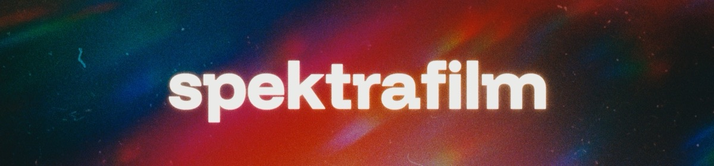

# spektrafilm para Adobe

[English](README.md) · **Español** · [Português](README.pt-BR.md)

Efecto nativo para After Effects y Premiere Pro que lleva
[spektrafilm](https://github.com/andreavolpato/spektrafilm), la simulación
espectral de película de Andrea Volpato, a las aplicaciones de Adobe. Renderiza
con el motor C++/GPU de
[spektrafilm-ofx](https://github.com/chaert-s/spektrafilm-ofx): Metal en macOS
y Vulkan en Windows.

**Versión 0.1.0.** Probada en After Effects y Premiere Pro en macOS (Apple
Silicon) y en Windows 11 (NVIDIA, Vulkan). No hay binarios publicados: compila
desde el código fuente.

## Qué hace

El efecto modela toda la cadena fotoquímica: la sensibilidad espectral y el
revelado del negativo, el copiado sobre papel o película de copia, y el
escaneo. Controles, en el orden del panel:

- **Film** y **Print**: 20 películas de cámara (Kodak Vision3, Portra, Ektar,
  Gold, Fujifilm y películas reversibles) y 8 papeles y películas de copia.
- **Film Format**: de 8mm a 70mm/IMAX, Super 35 por defecto. Define el tamaño
  físico del fotograma: el grano, la halación y la difusión tienen un tamaño en
  µm, así que se ven más grandes en formatos pequeños.
- **Input Color Space** y **Output Color Space**: 26 espacios, entre ellos
  sRGB, Rec.709, Rec.2020, Display P3, ACES y formatos log de cámara. Elige los
  que correspondan a tu material y tu proyecto; el efecto no lee la gestión de
  color de la aplicación.
- **Film Exposure** y **Print Exposure**, en EV.
- **Grain**: cantidad, saturación y animación. El grano animado cambia cada
  1/24 s del tiempo de la capa y se repite en el mismo instante.
- **Halation**: dispersión, intensidad, tamaño, fuerza por canal y refuerzo o
  protección de las altas luces.
- **Camera Diffusion** y **Print Diffusion**: filtros Glimmerglass, Black
  Pro-Mist, Pro-Mist y CineBloom, con núcleo, halo y bloom.

Kodak Ektachrome 100, Kodachrome 64, Fujifilm Velvia 100 y Provia 100F son
películas reversibles (diapositivas). Se escanean directamente, así que
**Print**, **Print Exposure** y **Print Diffusion** no se aplican; usa
**Film Exposure**.

## Compilar

Necesitas CMake 3.24 o posterior, Git, Python 3.11 o posterior y los SDK de
Adobe, que Adobe no permite redistribuir. Descárgalos de la consola de
desarrolladores de Adobe y extráelos de modo que existan estos archivos:

```text
sdks/after-effects/Examples/Headers/AE_Effect.h
sdks/premiere/Examples/Headers/PrSDKGPUFilter.h      (solo macOS)
```

- [After Effects C++ SDK](https://developer.adobe.com/console/servicesandapis/ae)
- [Premiere Pro C++ SDK](https://developer.adobe.com/console/servicesandapis/pr)

Otras ubicaciones se indican con `-DSPEKTRAFILM_AE_SDK_ROOT=...` y
`-DSPEKTRAFILM_PR_SDK_ROOT=...`.

`tools/bootstrap.py` descarga spektrafilm-ofx y los perfiles de spektrafilm en
los commits fijados en `upstream.lock.json` y aplica el parche de este port.
Python solo se usa durante el build, para generar las tablas espectrales.

### macOS

Xcode o las Command Line Tools.

```sh
python3 tools/bootstrap.py
python3 -m venv .venv
.venv/bin/python -m pip install -r requirements-build.txt
cmake -S . -B build -DCMAKE_BUILD_TYPE=Release -DSPEKTRAFILM_BUILD_ADOBE_PLUGIN=ON
cmake --build build --parallel
ctest --test-dir build --output-on-failure
```

El plugin queda en `build/plugin/SpektraFilm.plugin`, con firma ad hoc para uso
local.

### Windows

Visual Studio 2022 con la carga de trabajo de C++ (x64) y el
[Vulkan SDK](https://vulkan.lunarg.com/sdk/home#windows). Ejecuta desde un
*x64 Native Tools Command Prompt for VS 2022*:

```bat
python tools\bootstrap.py
python -m venv .venv
.venv\Scripts\python -m pip install -r requirements-build.txt
cmake -S . -B build -A x64 -DSPEKTRAFILM_BUILD_ADOBE_PLUGIN=ON
cmake --build build --config Release --parallel
ctest --test-dir build -C Release --output-on-failure
```

El plugin es la carpeta `build\plugin\SpektraFilm`, con el `.aex` en
`Contents\Win64` y sus datos en `Contents\Resources`. Conserva esa estructura.

## Instalar

Cierra After Effects y Premiere Pro y ejecuta:

```sh
python3 tools/install.py
```

En Windows ejecuta `python tools\install.py` desde una terminal de
administrador. El script copia el plugin a la carpeta compartida de plugins
MediaCore de Adobe, que leen ambas aplicaciones, y guarda la copia anterior en
`build/install-backups`:

- macOS: `~/Library/Application Support/Adobe/Common/Plug-ins/7.0/MediaCore`
- Windows: `C:\Program Files\Adobe\Common\Plug-ins\7.0\MediaCore`

Abre la aplicación y busca **spektrafilm** en la lista de efectos. En After
Effects, *File > Scripts > Run Script File* con `tests/after_effects_smoke.jsx`
lo aplica a una composición nueva.

## Limitaciones

- El efecto renderiza el fotograma completo; no admite región de interés ni
  render por mosaicos.
- En Windows los fotogramas pasan por la memoria de la CPU hasta el renderer
  Vulkan; los fotogramas GPU de Adobe solo se usan en macOS (Metal).
- Algunos controles de spektrafilm-ofx aún no están expuestos: acopladores DIR,
  ajustes del escáner y exposición automática.
- La salida recorta los colores fuera de gama; el spektrafilm actual los
  comprime en CAM16-UCS. Ver [docs/PARITY.md](docs/PARITY.md).
- El orden de los parámetros aún puede cambiar antes de la 1.0; en ese caso,
  los proyectos guardados con un build anterior pierden los valores de los
  controles.

## Documentación (en inglés)

- [Arquitectura](docs/ARCHITECTURE.md): fuentes, caminos de render y pruebas.
- [Paridad](docs/PARITY.md): comparación con el spektrafilm en Python.
- [Rendimiento](docs/PERFORMANCE.md): optimizaciones GPU, mediciones y las
  variables de entorno que restauran el cálculo exacto.

## Créditos

- [spektrafilm](https://github.com/andreavolpato/spektrafilm), de **Andrea
  Volpato**: el modelo de película y los perfiles de película y papel.
- [spektrafilm-ofx](https://github.com/chaert-s/spektrafilm-ofx), de **Aedan
  Diez** y colaboradores: el renderer nativo y el generador de tablas en los
  que se basa este port.
- [vkdt](https://github.com/hanatos/vkdt), de **Johannes Hanika**: el
  muestreo espectral Hanatos.
- **Mallett y Yuksel (2019)**: la reconstrucción espectral alternativa.

Avisos completos en [Legal/THIRD_PARTY_NOTICES.md](Legal/THIRD_PARTY_NOTICES.md).
Este port no está afiliado a Adobe ni a los autores anteriores, ni cuenta con su
respaldo.

## Licencia

[GPL-3.0](LICENSE). Los perfiles de spektrafilm tienen su propia licencia,
[Legal/SPEKTRAFILM_PROFILES_LICENSE.txt](Legal/SPEKTRAFILM_PROFILES_LICENSE.txt).
