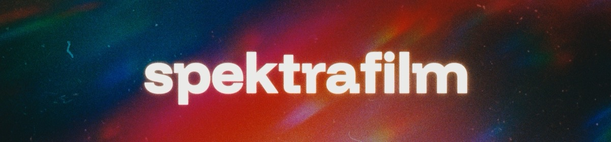

# spektrafilm para Adobe

[English](README.md) · [Español](README.es.md) · **Português**

Efeito nativo para After Effects e Premiere Pro que leva o
[spektrafilm](https://github.com/andreavolpato/spektrafilm), a simulação
espectral de filme de Andrea Volpato, para os aplicativos da Adobe. Renderiza
com o motor C++/GPU do
[spektrafilm-ofx](https://github.com/chaert-s/spektrafilm-ofx): Metal no macOS
e Vulkan no Windows.

**Versão 0.1.0.** Testada no After Effects e no Premiere Pro no macOS (Apple
Silicon). O build do Windows está escrito e revisado contra erros de
compilação, mas ainda não rodou no Windows. Não há binários publicados: compile
a partir do código-fonte.

## O que faz

O efeito modela toda a cadeia fotoquímica: a sensibilidade espectral e a
revelação do negativo, a cópia em papel ou filme de cópia, e o escaneamento.
Controles, na ordem do painel:

- **Film** e **Print**: 20 filmes de câmera (Kodak Vision3, Portra, Ektar,
  Gold, Fujifilm e filmes reversíveis) e 8 papéis e filmes de cópia.
- **Film Format**: de 8mm a 70mm/IMAX, Super 35 por padrão. Define o tamanho
  físico do quadro: grain, halation e diffusion têm tamanho em µm, então
  aparecem maiores em formatos pequenos.
- **Input Color Space** e **Output Color Space**: 26 espaços, entre eles sRGB,
  Rec.709, Rec.2020, Display P3, ACES e formatos log de câmera. Escolha os que
  correspondem ao seu material e ao projeto; o efeito não lê a gestão de cor do
  aplicativo.
- **Film Exposure** e **Print Exposure**, em EV.
- **Grain**: intensidade, saturação e animação. O grain animado muda a cada
  1/24 s do tempo da camada e se repete no mesmo instante.
- **Halation**: dispersão, intensidade, tamanho, força por canal e reforço ou
  proteção das altas luzes.
- **Camera Diffusion** e **Print Diffusion**: filtros Glimmerglass, Black
  Pro-Mist, Pro-Mist e CineBloom, com núcleo, halo e bloom.

Kodak Ektachrome 100, Kodachrome 64, Fujifilm Velvia 100 e Provia 100F são
filmes reversíveis (cromos). Eles são escaneados diretamente, então **Print**,
**Print Exposure** e **Print Diffusion** não se aplicam; use **Film Exposure**.

## Compilar

São necessários CMake 3.24 ou mais recente, Git, Python 3.11 ou mais recente e
os SDKs da Adobe, que a Adobe não permite redistribuir. Baixe-os no console de
desenvolvedores da Adobe e extraia de modo que estes arquivos existam:

```text
sdks/after-effects/Examples/Headers/AE_Effect.h
sdks/premiere/Examples/Headers/PrSDKGPUFilter.h      (só macOS)
```

- [After Effects C++ SDK](https://developer.adobe.com/console/servicesandapis/ae)
- [Premiere Pro C++ SDK](https://developer.adobe.com/console/servicesandapis/pr)

Outros caminhos podem ser indicados com `-DSPEKTRAFILM_AE_SDK_ROOT=...` e
`-DSPEKTRAFILM_PR_SDK_ROOT=...`.

O `tools/bootstrap.py` baixa o spektrafilm-ofx e os perfis do spektrafilm nos
commits fixados em `upstream.lock.json` e aplica o patch deste port. O Python
só é usado durante o build, para gerar as tabelas espectrais.

### macOS

Xcode ou as Command Line Tools.

```sh
python3 tools/bootstrap.py
python3 -m venv .venv
.venv/bin/python -m pip install -r requirements-build.txt
cmake -S . -B build -DCMAKE_BUILD_TYPE=Release -DSPEKTRAFILM_BUILD_ADOBE_PLUGIN=ON
cmake --build build --parallel
ctest --test-dir build --output-on-failure
```

O plugin fica em `build/plugin/SpektraFilm.plugin`, com assinatura ad hoc para
uso local.

### Windows

Visual Studio 2022 com a carga de trabalho de C++ (x64) e o
[Vulkan SDK](https://vulkan.lunarg.com/sdk/home#windows). Rode a partir de um
*x64 Native Tools Command Prompt for VS 2022*:

```bat
python tools\bootstrap.py
python -m venv .venv
.venv\Scripts\python -m pip install -r requirements-build.txt
cmake -S . -B build -A x64 -DSPEKTRAFILM_BUILD_ADOBE_PLUGIN=ON
cmake --build build --config Release --parallel
ctest --test-dir build -C Release --output-on-failure
```

O plugin é a pasta `build\plugin\SpektraFilm`, com o `.aex` em
`Contents\Win64` e os dados em `Contents\Resources`. Mantenha essa estrutura.

## Instalar

Feche o After Effects e o Premiere Pro e rode:

```sh
python3 tools/install.py
```

No Windows, rode `python tools\install.py` em um terminal de administrador. O
script copia o plugin para a pasta compartilhada de plugins MediaCore da Adobe,
que os dois aplicativos leem, e guarda a cópia anterior em
`build/install-backups`:

- macOS: `~/Library/Application Support/Adobe/Common/Plug-ins/7.0/MediaCore`
- Windows: `C:\Program Files\Adobe\Common\Plug-ins\7.0\MediaCore`

Abra o aplicativo e procure **spektrafilm** na lista de efeitos. No After
Effects, *File > Scripts > Run Script File* com `tests/after_effects_smoke.jsx`
aplica o efeito numa composição nova.

## Limitações

- O efeito renderiza o quadro inteiro; região de interesse e render em blocos
  não são suportados.
- No Windows os quadros passam pela memória da CPU até o renderer Vulkan; os
  quadros GPU da Adobe só são usados no macOS (Metal).
- Alguns controles do spektrafilm-ofx ainda não estão expostos: acopladores
  DIR, ajustes do scanner e exposição automática.
- A saída corta as cores fora do gamut; o spektrafilm atual as comprime em
  CAM16-UCS. Veja [docs/PARITY.md](docs/PARITY.md).
- A ordem dos parâmetros ainda pode mudar antes da 1.0; nesse caso, projetos
  salvos com um build anterior perdem os valores dos controles.

## Documentação (em inglês)

- [Arquitetura](docs/ARCHITECTURE.md): fontes, caminhos de render e testes.
- [Paridade](docs/PARITY.md): comparação com o spektrafilm em Python.
- [Desempenho](docs/PERFORMANCE.md): otimizações de GPU, medições e as
  variáveis de ambiente que restauram o cálculo exato.

## Créditos

- [spektrafilm](https://github.com/andreavolpato/spektrafilm), de **Andrea
  Volpato**: o modelo de filme e os perfis de filme e papel.
- [spektrafilm-ofx](https://github.com/chaert-s/spektrafilm-ofx), de **Aedan
  Diez** e colaboradores: o renderer nativo e o gerador de tabelas em que este
  port se baseia.
- [vkdt](https://github.com/hanatos/vkdt), de **Johannes Hanika**: o
  upsampling espectral Hanatos.
- **Mallett e Yuksel (2019)**: a reconstrução espectral alternativa.

Avisos completos em [Legal/THIRD_PARTY_NOTICES.md](Legal/THIRD_PARTY_NOTICES.md).
Este port não é afiliado à Adobe nem aos autores acima, nem endossado por eles.

## Licença

[GPL-3.0](LICENSE). Os perfis do spektrafilm têm licença própria,
[Legal/SPEKTRAFILM_PROFILES_LICENSE.txt](Legal/SPEKTRAFILM_PROFILES_LICENSE.txt).
